  

  

  
  
  

---

## Sobre mí

Soy desarrollador full stack. Construyo aplicaciones web de punta a punta (API en **.NET**, interfaz en **React + TypeScript**, datos en **PostgreSQL**) y herramientas de escritorio en **Python**.

- Trabajo ahora en un **ERP modular** que cubre capacitación, monitoreo de plantas de almacenamiento de energía, nómina, recursos humanos y gastos.
- Me interesa el software que resuelve problemas concretos de negocio y la IA aplicada que corre en local.
- Si quieres hablar de un proyecto o una oportunidad, escríbeme por LinkedIn, correo o WhatsApp.

---

## En qué trabajo ahora

<table>
  <tr>
    <td>
      <h3>ERP modular</h3>
      
      
      
      
      
      
      
Un sistema de gestión empresarial dividido en módulos independientes que comparten la autenticación y la base de datos:

      <ul>
        <li><b>TMS</b>: plataforma de capacitación con cursos grabados y emisión de certificados</li>
        <li><b>OmniOps</b>: monitoreo de plantas eléctricas que almacenan energía en baterías de litio</li>
        <li><b>Nómina</b> y <b>Recursos humanos</b></li>
        <li><b>Gastos</b></li>
        <li><b>Autenticación</b> y control de acceso</li>
      </ul>
    </td>
  </tr>
</table>

---

## Proyectos

<table>
  <tr>
    <td width="50%" valign="top">
      <h3><a href="https://github.com/JHONATAN-99/SeparadorPista">SeparadorPista</a></h3>
      
      
      
      
App de escritorio para Windows que separa una canción en 2, 4 o 6 pistas (voz, batería, bajo, guitarra, piano) con IA. Todo corre en local y sin internet, aprovecha la GPU si la hay y se puede cancelar sin congelar la ventana.

    </td>
    <td width="50%" valign="top">
      <h3><a href="https://github.com/JHONATAN-99/Simulador">Simulador QPACK</a></h3>
      
      
      
Simulador en el navegador de QPACK, la compresión de cabeceras de HTTP/3. Implementa el codificador y el decodificador con la tabla estática y la tabla dinámica del protocolo.

    </td>
  </tr>
  <tr>
    <td width="50%" valign="top">
      <h3><a href="https://github.com/JHONATAN-99/Web">Tareas + Drive (MERN)</a></h3>
      
      
      
      
      
      
Aplicación full stack de tareas con registro e inicio de sesión (JWT y bcrypt), rutas protegidas y un espacio tipo Drive para subir y gestionar archivos. Frontend en React + Vite y API en Express con MongoDB.

    </td>
    <td width="50%" valign="top">
      <h3><a href="https://github.com/JHONATAN-99/SalonUnias">Salón de belleza</a></h3>
      
      
      
Aplicación web para un salón: catálogo de servicios con precio y duración, calendario de reservas y acceso para el administrador, con componentes de interfaz reutilizables.

    </td>
  </tr>
  <tr>
    <td width="50%" valign="top">
      <h3><a href="https://github.com/JHONATAN-99/ArquiII">Monitor de temperatura</a></h3>
      
      
      
Panel web que muestra en tiempo real la temperatura de un sensor guardada en Firebase Realtime Database, con historial de lecturas e inicio de sesión.

    </td>
    <td width="50%" valign="top">
      <h3>¿Y después?</h3>
      
Más módulos del ERP y nuevas herramientas de escritorio con IA local. Si tienes una idea o un proyecto, <a href="https://www.linkedin.com/in/jhonatan-albert-fuentes-cejas-049970444">hablemos</a>.

    </td>
  </tr>
</table>

---

## Stack

<table align="center">
  <tr>
    <td align="center"><b>Backend</b></td>
    <td align="center"><b>Frontend</b></td>
    <td align="center"><b>Datos</b></td>
    <td align="center"><b>Escritorio e IA</b></td>
    <td align="center"><b>Herramientas</b></td>
  </tr>
  <tr>
    <td align="center"></td>
    <td align="center"></td>
    <td align="center"></td>
    <td align="center"></td>
    <td align="center"></td>
  </tr>
</table>

---

## Actividad

  <picture>
    <source media="(prefers-color-scheme: dark)" srcset="https://github-readme-stats.vercel.app/api?username=JHONATAN-99&amp;show_icons=true&amp;hide_border=true&amp;locale=es&amp;include_all_commits=true&amp;count_private=true&amp;bg_color=0d1117&amp;title_color=58a6ff&amp;text_color=c9d1d9&amp;icon_color=58a6ff" />
    
  </picture>
  &nbsp;
  <picture>
    <source media="(prefers-color-scheme: dark)" srcset="https://streak-stats.demolab.com?user=JHONATAN-99&amp;locale=es&amp;hide_border=true&amp;background=0d1117&amp;ring=58a6ff&amp;fire=a855f7&amp;currStreakLabel=58a6ff&amp;sideLabels=c9d1d9&amp;currStreakNum=ffffff&amp;sideNums=ffffff&amp;dates=8b949e&amp;stroke=30363d" />
    
  </picture>

  

